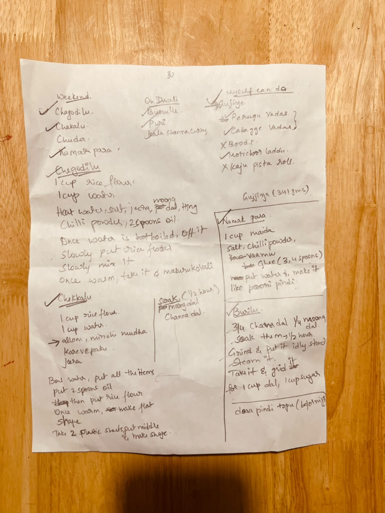

# Burelu (బూరెలు)

## Ingredients
- ¾ chana dal (శనగపప్పు) and ¼ moong dal (పెసరపప్పు)
- 1 cup sugar (పంచదార) for every 1 cup of dal
- Dosa batter (దోశ పిండి) for coating

## Instructions
1. Soak the dals for 1½ hours.
2. Grind, put it in the idli stand and steam it.
3. Take it out and grind it with the sugar.
4. Dip in dosa batter and fry [her note says "dosa pindi topu (before frying)", so the dip-and-fry step was filled in].

## Open questions
- "¾ chana dal ¼ moong dal" has no unit. Is that cups?

## Amma's handwriting

{ loading=lazy }
